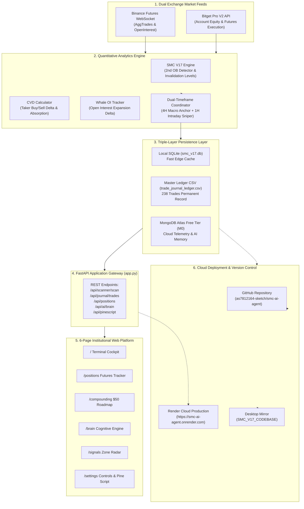

# 🏛️ System Architecture: SMC V17 Crypto Sniper

## 1. High-Level Architecture Diagram

---

## 2. Component Descriptions

### 2.1 Market Feed Layer
* **Binance Futures API / WebSocket**: Ingests real-time tick-by-tick aggregated trades (`aggTrade`) and open interest snapshots (`openInterest`) across 50 top crypto pairs. Computes high-precision Cumulative Volume Delta (CVD) and OI velocity.
* **Bitget Pro V2 API**: Tracks real-time wallet equity balance (`$77.59 USDT`), unrealized PnL, margin ratio, and maintains pending 2nd OB limit orders.

### 2.2 Core Analytics Engine
* **`engine/smc_v17.py`**: Identifies Swing Highs/Lows, Structure Breaks (BOS/CHoCH), and detects 1st and 2nd Order Blocks. Strictly locks:
  - **BUY**: Entry at `ob_high` (Top Boundary).
  - **SELL**: Entry at `ob_low` (Bottom Boundary).
* **`engine/cvd_calculator.py`**: Computes taker buy volume minus taker sell volume. Flags absorption when price hits OB boundary and CVD aggressively curls in the trade direction.
* **`engine/oi_tracker.py`**: Tracks $\Delta OI$. Filters out retail exhaustion moves; only fires when new capital ($\Delta OI > +0.5\%$) backs the bounce.
* **`engine/dual_timeframe_sniper.py`**: Coordinates 4H macro directional conviction with 1H precision execution.

### 2.3 Triple-Layer Persistence Layer
1. **Local SQLite (`database/smc_v17.db`)**: Provides zero-latency response for local queries and running processes.
2. **Master CSV (`trade_journal_ledger.csv`)**: Universal, human-readable ledger containing 238 historical audit trades.
3. **MongoDB Atlas (Free Tier M0)**: Cloud NoSQL database with 512 MB storage. Stores live telemetry, market scans, and AI cognitive lessons without loss during server restarts.

### 2.4 FastAPI Service Gateway (`app.py`)
* Serves static HTML assets across 6 dedicated routes.
* Dispatches asynchronous scan routines.
* Exposes clean JSON APIs with CORS and error handling.
* Streams Telegram alerts via webhook dispatcher.

---

## 3. Data Flow Sequence
1. **Price Action Update**: Candle closes on 1H or 4H chart.
2. **Zone Identification**: Engine computes swing points and marks 2nd OB boundaries.
3. **First-Tap Detection**: Price enters the buffer zone of the 2nd OB top boundary (`ob_high` for Long).
4. **Confluence Check**:
   - Is CVD reversing ↗?
   - Is $\Delta OI > +0.5\%$?
   - Is confluence score $\ge 85$?
5. **Execution / Alert**:
   - If Auto-Trading is ON (user-authorized): Dispatches 5x isolated limit order to Bitget.
   - If Auto-Trading is PAUSED (default): Sends high-priority Telegram alert and logs to Signal Radar.
6. **Journal Recording**: Trade lifecycle (Entry, Breakeven Shift, TP/SL exit) logged to SQLite, CSV, and MongoDB.
