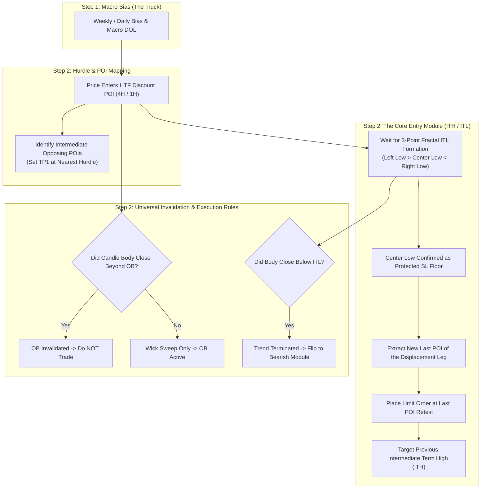

# HERMES MSOB 4.0 — Step 2 Master Notes
## The Institutional Entry Module & Execution Architecture: ITH/ITL Fractals, POI Hurdles, and Multi-Timeframe Synchronization

> **Core Masterclass Sources:**
> - **Video 19 (`3cgI90d_aqs`):** *How to Use Market Bias Properly | Entry, Structure & Lower Timeframe Traps Explained* (1h 06m 16s)
> - **Video 20 (`m_IHo3SkQLY`):** *How to Use Bias Properly (Part 2) | Multi-Timeframe Bias, Bias With Structure & Doubts Solving* (1h 17m 28s)
> **Mentor:** Shoaib Khan (MS Trading / MSOB)  
> **Status:** Step 2 Synthesized & Verified | Complete Entry Module  
> **Framework:** HERMES AI Institutional SMC Suite (Zero Retail Indicators)

---

## 1. Executive Synthesis: From Bias Identification to Precision Execution
In **Step 1**, we established the **Top-Down Bias Trilogy** (Weekly/Daily Macro Truck, 4 Market Regimes, Equilibrium 50%, and Liquidity Draws).  
However, knowing the direction is only 30% of the battle. In **Step 2**, Shoaib Khan codifies the missing 70%: **The Exact Mechanical Entry Module**.

Traders lose money despite correct bias because:
1. They enter on the first 5m candle without structural confirmation (the 5m Trap).
2. They hold greedily toward macro targets while ignoring opposing intermediate POIs (Hurdles).
3. They guess which Discount POI (Breaker, OTE, or Extreme OB) will hold.
4. They do not know the exact mathematical condition when an Order Block or Trend has failed.

---

## 2. Complete Step 2 Structural Architecture

---

## 3. The 5 Pillars of the Institutional Entry Module

### Pillar I: The 3-Point Fractal Structure (ITH & ITL)
Shoaib Khan reveals the exact institutional definition of Market Structure:
1. **Intermediate Term Low (ITL):**
   - A 3-point fractal trough:
     - **Point 1 (Left Low):** Must be higher than the Center Low.
     - **Point 2 (Center Low):** The absolute lowest point (extreme swing low).
     - **Point 3 (Right Low):** Must be higher than the Center Low.
   - When formed inside a higher-timeframe Demand POI, the Center Low is certified as the **Protected Floor**.
   - **Institutional Law (Bullish):** The **ITL MUST REMAIN SAFE**. Stop loss is placed strictly below this Center Low.
2. **Intermediate Term High (ITH):**
   - A 3-point fractal peak:
     - **Point 1 (Left High):** Lower than the Center High.
     - **Point 2 (Center High):** The absolute highest point (extreme peak).
     - **Point 3 (Right High):** Lower than the Center High.
   - **Institutional Law (Bullish):** The **ITH IS THE DYNAMIC TARGET AND MUST BE BROKEN**.
   - Target (TP) is placed strictly at the ITH.
3. **Execution Sequence:**
   - Wait for ITL completion.
   - Buy the retest of the new Order Block / FVG formed on the push out of ITL.
   - Take profit at ITH.
   - When ITH is breached, do NOT take counter-trend shorts! Wait for the new 3-point ITH to form, then wait for the next 3-point ITL, and buy the next retest.

---

### Pillar II: Trend Invalidation & Reversal Law
- **Bullish Trend Continuity:** As long as price respects every successive ITL and breaks every successive ITH, the Bullish bias is active.
- **The Reversal Shift:**
  - The exact moment a candle of that timeframe **CLOSES WITH ITS BODY BELOW THE PROTECTED ITL**, the Bullish trend is **INSTANTLY TERMINATED**.
  - Market structure flips immediately to **Bearish**.
  - Roles invert: The previous ITH becomes the **Protected Ceiling (SL)**, and the next ITL becomes the **Target (TP)**.

---

### Pillar III: Order Block Invalidation Law (Candle Body vs Wick)
Traders frequently get stopped out trying to trade broken Order Blocks. Shoaib defines the universal invalidation law:
- **Valid Reaction (Wick Sweep):** If price penetrates an Order Block with a wick but closes back inside or above the boundary, it is a valid institutional liquidity grab (Turtle Soup). The OB remains active.
- **Terminal Invalidation (Body Close):** If a candle on the **same timeframe as the Order Block CLOSES WITH ITS BODY beyond the Order Block boundary**, that Order Block is **PERMANENTLY DEAD**.
- **Action:** Purge the zone immediately. Never place limit orders or attempt retests on an invalidated OB.

---

### Pillar IV: The 3-Zone Discount Hierarchy (Universal POI Resolution)
When price retraces into a 50% Equilibrium Discount, traders face 3 candidate zones:
1. **Breaker / Mitigation Block** (Upper Discount)
2. **Optimal Trade Entry (OTE 0.618 – 0.79) FVG/OB** (Mid Discount)
3. **Extreme Last POI / Origin Order Block** (Deep Discount)

#### The Solution (Zero Guesswork):
- No institution or trader can predict in advance which of the 3 zones will hold.
- **The Lower Timeframe (5m) Confirmation Gate:**
  - Whichever zone price taps and produces a **5m Market Structure Shift (MSS) + ITL formation**, THAT zone is the true institutional reversal floor.
  - If Zone 1 gets tapped and gives 5m MSS $\to$ Execute on Zone 1.
  - If Zone 1 gets sliced without 5m MSS $\to$ Let price drop to Zone 2 (OTE).
  - If Zone 2 gives 5m MSS $\to$ Execute on Zone 2.
  - If Zone 2 gets sliced $\to$ Wait for Zone 3 (Extreme Last POI).

---

### Pillar V: The Intermediate POI (Hurdle) Doctrine & 75% Stop Compression
- **The Hurdle Rule:** Even with a clear macro Draw on Liquidity (Weekly High), any opposing Daily/4H POI in between is an **Intermediate Hurdle**. **TP1 MUST be locked at the Hurdle.**
- **The 5m Trap Elimination:** Never buy the first 5m green candle inside a 1H POI. Wait for 5m MSS body close, then enter strictly at the **Last POI** of the displacement leg.
- **Risk Compression:** Reduces Stop Loss from 1,000 pips (1H direct) to 200–250 pips (5m Last POI), expanding Reward-to-Risk from **1:3 to 1:11 – 1:15 RR**!

---

## 4. Multi-Timeframe Synchronization Matrix

| Higher Timeframe POI (Anchor) | Execution Timeframe | Structural Pivot Trigger | Target Gating |
| :--- | :--- | :--- | :--- |
| **Weekly (`1W`) POI** | **4-Hour (`4H`)** | 4H ITL formation + 4H MSS | 4H ITH $\to$ Daily Hurdle $\to$ Weekly DOL |
| **Daily (`1D`) POI** | **1-Hour (`1H`)** | 1H ITL formation + 1H MSS | 1H ITH $\to$ 4H Hurdle $\to$ Daily DOL |
| **4-Hour (`4H`) POI** | **15-Minute (`15m`)** | 15m ITL formation + 15m MSS | 15m ITH $\to$ 1H Hurdle $\to$ 4H DOL |
| **1-Hour (`1H`) POI** | **5-Minute (`5m`)** | 5m ITL formation + 5m MSS | 5m ITH $\to$ 1H Hurdle (Floor: Never drop below 5m) |

---

## 5. Candle Range Theory (CRT) in Consolidation / No-POI Regimes
When all HTF POIs have been tapped and filled (Regime 4 / Sideways Range):
- The algorithm shifts from Trend Expansion to **Liquidity Harvesting**.
- Strategy switches to **CRT (Candle Range Theory)**:
  - Mark Previous Day High (PDH) and Previous Day Low (PDL) or Asian Session High/Low.
  - Wait for an aggressive wick sweep outside the range.
  - Enter upon candle close back inside the range, targeting internal 50% equilibrium or opposite range liquidity.
