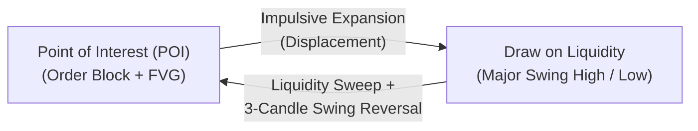
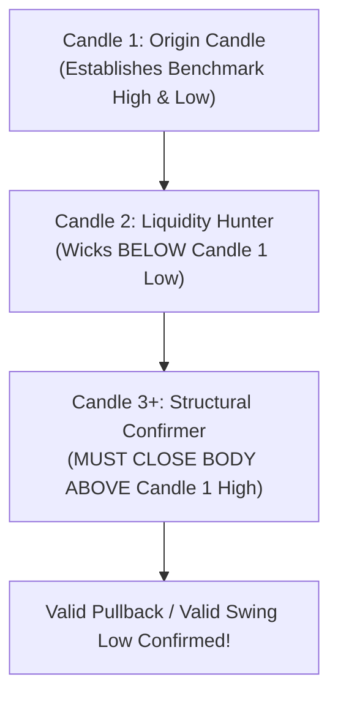

# Video Dossier: How to Find Bias Like a Pro (Part 4)
## Full Bias Breakdown + Bitcoin Institutional Footprint + Comprehensive Doubt Solving

> **Source Video:** [How to Find Bias Like a Pro (Part 4) | Full Bias Breakdown + Bitcoin Analysis + Doubt Solving](https://youtu.be/eA_hKYAVweo)  
> **Instructor:** Shoaib Khan (MS Trading)  
> **Duration:** 51 Minutes 06 Seconds (3,066 Seconds)  
> **Architecture Target:** HERMES MSOB 4.0 Institutional Algorithmic Trading Suite  

---

## 1. Executive Summary & Forensic Overview

In this 51-minute masterclass, Shoaib Khan addresses the core failure points that cause retail traders to get stopped out even when they conceptually understand Smart Money Concepts (SMC). The masterclass is divided into three critical pillars:
1. **The Pure Mechanical Reality of Bias:** Market movement is governed entirely by an eternal binary loop: **POI $\longleftrightarrow$ Liquidity**. There is no third state.
2. **The "1-Hour Minimum" Inviolable Law:** The number one reason traders lose money is dropping to micro-timeframes (1m/3m/5m) prematurely, getting chopped by internal liquidity hunts, and placing sub-micro stop losses.
3. **Asset-Specific Behavioral Peculiarities (Bitcoin vs Forex/Gold):** Why Bitcoin does not follow standard POI-to-Liquidity delivery, but instead acts as a **Liquidity-to-Liquidity sweep engine** where Order Blocks are routinely breached before expanding.

---

## 2. The Sovereign Law of Two States: POI $\longleftrightarrow$ Liquidity

Market price delivery operates in a perpetual closed loop between two institutional anchors:

### The Three Operational Scenarios:
1. **Scenario 1 — Price is Currently at a POI:**
   - Direction/Bias is **100% targeted toward opposing Liquidity** (Major Swing High in an uptrend, Major Swing Low in a downtrend).
   - Traders search exclusively for pro-trend continuation entries.
2. **Scenario 2 — Price has Purged Major Liquidity:**
   - Direction/Bias shifts to **Counter-Trend Pullback toward an unmitigated POI** (Origin Demand/Supply).
   - Reversal confirmation requires a confirmed **3-Candle Swing Reversal**.
3. **Scenario 3 — Price is Mid-Range ("Between Levels"):**
   - Traders must inspect the **Point of Origin**:
     - If price recently departed a confirmed POI, the bias remains firmly committed to the Liquidity target.
     - Lower timeframes (1H / 15m) will print internal structural sub-cycles flowing directly toward the macro target.

---

## 3. Multi-Timeframe Priority & Conflict Resolution

### A. Monthly Liquidity Swept vs Distant Monthly POI
- **Retail Misconception:** "If Monthly Liquidity is purged, price must crash all the way back down to the Monthly POI before going higher."
- **Institutional Reality:** When macro trend momentum is aggressively bullish, price will NOT retrace hundreds of pips to a distant Monthly POI, as doing so would destroy the macro bullish market structure. Instead, price intercepts an **intermediate Weekly or Daily POI** and immediately resumes its macro trajectory.
- **Rule:** If the higher-timeframe POI is excessively distant, the market will utilize the nearest unmitigated intermediate timeframe POI (Daily/4H) that aligns with the macro Order Flow.

### B. 4H Counter-Trend Hurdles vs 1H Demand POIs
- **The Core Paradox:** Why does a smaller 1H Demand POI frequently smash through and destroy a larger 4H Supply POI?
- **The Institutional Law of Backing:** A 1H Demand POI that was created off a **Daily Master POI** inherits the full kinetic backing of that Daily POI. Therefore, when price pushes up from that 1H POI into a counter-trend 4H POI, the 1H POI has superior institutional capital behind it and shatters the 4H resistance hurdle.

---

## 4. The 1-Hour Timeframe Rule: Eliminating Micro-Noise

> [!IMPORTANT]
> **Shoaib Khan's Direct Injunction:**  
> *"Starting mein aapko 1-Hour ke time frame ke niche jaana hi nahi hai! Agar aap 1-Hour ke niche ja rahe ho, to obviously aapka SL lagega."*

### Why Traders Fail on 1m / 5m:
- On 1m/5m, noise, spread, and algorithmic sweeps hunt resting stops continuously.
- Retail traders see micro-MSS every 5 minutes and flip their bias back and forth 4 to 5 times in a single session, accumulating cascading losses.

### The Standardized 1H Execution Protocol:
1. **Identify POI & Structure exclusively on 1-Hour and 4-Hour charts.**
2. When price reaches a 1H POI, drop to 5m **only to observe the entry trigger** (MSS + displacement).
3. **Stop Loss Placement Rule:** Do NOT place the Stop Loss tightly under the 5m micro-candle wick. In the initial phase, keep the Stop Loss safely positioned below the **1-Hour POI invalidation level**.
4. **Trailing Phase:** Only after price establishes a confirmed higher-timeframe swing (or intermediate 1H structure) should the Stop Loss be trailed.

### Live Proof on Gold (XAUUSD):
- In the video chart audit, sticking strictly to 1H POIs provided **5 to 6 consecutive massive winning swings** yielding **+800 to +1,100 pips each**, with only a single stop-out across several weeks of trading.

---

## 5. Valid vs Invalid Pullback: The 3-Candle Swing Mechanics

A critical doubt resolved by Shoaib Khan is the exact mechanical criteria for a **Valid Pullback / Valid Swing Point** (which defines valid Inducement / IDM).

### Mechanical Rules:
1. **Candle 1 (Benchmark):** Establishes the initial high and low wick boundaries.
2. **Candle 2 (Sweep):** Must purge the liquidity of Candle 1 (its low for a bullish pullback, or its high for a bearish pullback). Closing position does not matter.
3. **Candle 3 or Later (Confirmation Close):** A subsequent candle (can be Candle 3, 4, 5, etc.) **must close its body beyond the opposing extreme of Candle 1** (above Candle 1's high for bullish; below Candle 1's low for bearish).
4. **Inducement (IDM) Sentry Rule:** If a pullback fails this candle body close condition, it is an **INVALID SWING**. An invalid swing **CANNOT** serve as an Inducement level. If the algorithm marks an invalid swing as IDM, it will create false entries.

---

## 6. Bitcoin (BTC) Behavioral Footprint: The Liquidity-to-Liquidity Machine

Shoaib Khan dedicated an extensive segment of the masterclass to Bitcoin's idiosyncratic price delivery:

| Parameter | Traditional Forex / Gold | Bitcoin (Crypto) |
| :--- | :--- | :--- |
| **Primary Delivery Model** | POI $\longrightarrow$ Liquidity | **Liquidity $\longrightarrow$ Liquidity** |
| **Order Block Respect** | Clean touch on 50% / Open of OB | **Routinely sweeps through OB extreme** |
| **Stop Hunt Behavior** | Rare deep wicks beyond OB | **Standard "Turtle Soup" / wick purge on nearly every POI** |
| **Execution Trigger** | Enter on first tap + MSS | **Wait for POI Liquidity Sweep + Reclaim** |

### The Bitcoin Institutional Protocol:
- In Bitcoin, an Order Block is frequently used by market makers as an **accumulation zone** where retail stop-losses are gathered.
- Rather than front-running the OB, institutional traders wait for Bitcoin to **wick below the Order Block low** (hunting retail breakout shorts & stop losses), and then enter when price **violently reclaims the OB range** with an impulsive candle close.

---

## 7. Trader Psychology & Execution Discipline

1. **The Bruce Lee Principle:**
   - *"I fear not the man who has practiced 10,000 kicks once, but I fear the man who has practiced one kick 10,000 times."*
   - Traders jump between SMC, ICT, CRT, CISD, and retail indicators the moment they hit one stop-loss. True edge comes from executing **100+ trades on a single standardized setup** without flinching.
2. **The Terminal Shutdown Rule:**
   - When the pre-calculated daily profit target is reached on Trade 1, **immediately shut down the trading terminal**. Taking additional trades due to euphoria destroys dopamine discipline and leads to revenge over-trading.
3. **Accepting Drawdown as Operating Cost:**
   - Even an elite 70-80% institutional strategy will experience 2 to 3 consecutive stop-outs during complex consolidation regimes. Do not alter system parameters after an isolated loss.

---

## 8. Photographic Keyframe Audit Registry

The 12 extracted visual keyframes from `v_bias4.mp4` document each stage of the masterclass:

1. [01_04m00s_bias_roadmap.jpg](file:///C:/Users/power/.gemini/antigravity/brain/cf8480f7-6fe5-4496-9c76-80211255c078/v_bias4_frames/01_04m00s_bias_roadmap.jpg) — Theoretical roadmap: Binary states of POI $\to$ Liquidity.
2. [02_08m30s_htf_vs_ltf_bias.jpg](file:///C:/Users/power/.gemini/antigravity/brain/cf8480f7-6fe5-4496-9c76-80211255c078/v_bias4_frames/02_08m30s_htf_vs_ltf_bias.jpg) — Visual demonstration of internal LTF sub-structure flowing toward HTF targets.
3. [03_13m00s_doubt_weekly_vs_daily.jpg](file:///C:/Users/power/.gemini/antigravity/brain/cf8480f7-6fe5-4496-9c76-80211255c078/v_bias4_frames/03_13m00s_doubt_weekly_vs_daily.jpg) — Multi-timeframe conflict resolution: Monthly vs Weekly POI hierarchy.
4. [04_17m30s_consolidation_bias.jpg](file:///C:/Users/power/.gemini/antigravity/brain/cf8480f7-6fe5-4496-9c76-80211255c078/v_bias4_frames/04_17m30s_consolidation_bias.jpg) — Handling 4H supply hurdles during an active Daily bullish trend.
5. [05_22m00s_btc_macro_weekly.jpg](file:///C:/Users/power/.gemini/antigravity/brain/cf8480f7-6fe5-4496-9c76-80211255c078/v_bias4_frames/05_22m00s_btc_macro_weekly.jpg) — Daily Gold chart breakdown showing the 3-candle failure and waiting discipline.
6. [06_26m30s_btc_daily_structure.jpg](file:///C:/Users/power/.gemini/antigravity/brain/cf8480f7-6fe5-4496-9c76-80211255c078/v_bias4_frames/06_26m30s_btc_daily_structure.jpg) — 1H Gold transition: Showing entry after displacement and FVG retest.
7. [07_31m00s_btc_4h_1h_execution.jpg](file:///C:/Users/power/.gemini/antigravity/brain/cf8480f7-6fe5-4496-9c76-80211255c078/v_bias4_frames/07_31m00s_btc_4h_1h_execution.jpg) — Trade management: Gold long capturing +1,100 pips with SL under 1H POI.
8. [08_35m30s_news_volatility_filter.jpg](file:///C:/Users/power/.gemini/antigravity/brain/cf8480f7-6fe5-4496-9c76-80211255c078/v_bias4_frames/08_35m30s_news_volatility_filter.jpg) — Systematic demonstration of 5 consecutive 1H winning trades on Gold.
9. [09_40m00s_gold_btc_divergence.jpg](file:///C:/Users/power/.gemini/antigravity/brain/cf8480f7-6fe5-4496-9c76-80211255c078/v_bias4_frames/09_40m00s_gold_btc_divergence.jpg) — The psychological patience required: Waiting 9+ hours between high-probability setups.
10. [10_44m30s_invalidation_threshold.jpg](file:///C:/Users/power/.gemini/antigravity/brain/cf8480f7-6fe5-4496-9c76-80211255c078/v_bias4_frames/10_44m30s_invalidation_threshold.jpg) — Valid vs Invalid pullback mechanics & 3-candle confirmation.
11. [11_48m00s_psychology_patience.jpg](file:///C:/Users/power/.gemini/antigravity/brain/cf8480f7-6fe5-4496-9c76-80211255c078/v_bias4_frames/11_48m00s_psychology_patience.jpg) — Bitcoin on-chart audit proving repeated POI liquidity sweeps before expansion.
12. [12_50m30s_bias_part4_summary.jpg](file:///C:/Users/power/.gemini/antigravity/brain/cf8480f7-6fe5-4496-9c76-80211255c078/v_bias4_frames/12_50m30s_bias_part4_summary.jpg) — Final summary: Sticking to 1 single strategy, mastering 1 kick 10,000 times.

---

## 9. Architectural Integration into HERMES MSOB 4.0 Suite

The insights from Bias Part 4 directly refine our algorithmic modules:
1. **Refinement for Step 3 (HTF POI Watchdog):**
   - For BTCUSDT, add a **Turtle Soup Purge Flag**: Allow a buffer of wick expansion below the 1H POI; trigger entry only when 5m candle body reclaims the 1H POI boundary.
2. **Refinement for Step 4 (LTF Real MSS):**
   - Integrate the **Valid Pullback Law** into fractal IDM recognition: A swing high/low must possess a confirmed candle body close beyond Candle 1 to qualify as a valid structural pivot.
3. **Refinement for Step 5 (Golden Last POI Extraction & 75% Compressed SL):**
   - Incorporate the **1H Protective Floor Rule**: While the primary entry is taken on the 5m Golden Last POI with a compressed SL, the macro risk boundary must reference the structural 1H swing floor to avoid premature stop-outs during crypto volatility.

---
*Dossier codified and locked for Hermes MSOB 4.0 Institutional Algorithmic Trading Architecture.*
