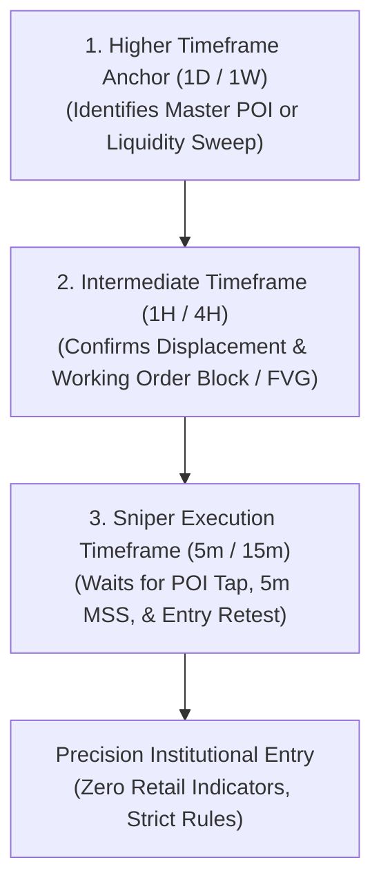
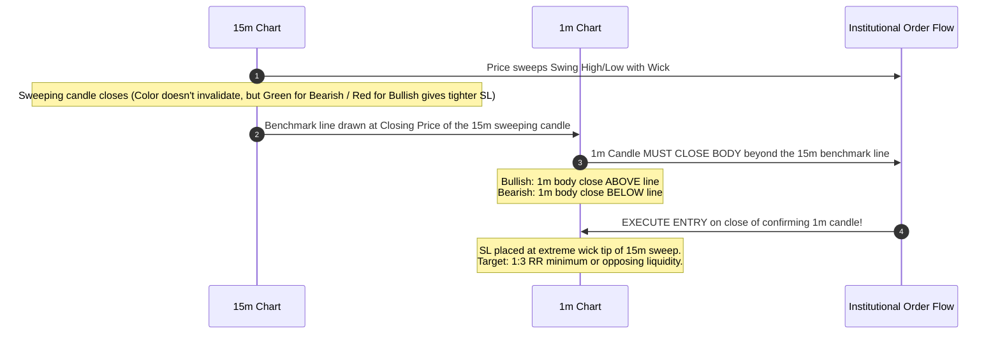

# Video Dossier: Complete Bias Breakdown + Entry Explained + Trading Strategy Simplified
## Institutional Entry Models, First vs Last POI Architecture & Execution Sentinel

> **Source Video:** [Complete Bias Breakdown + Entry Explained + Trading Strategy Simplified | Doubts Solving Class](https://youtu.be/QqOhj69KJRY)  
> **Instructor:** Shoaib Khan (MS Trading)  
> **Duration:** 43 Minutes 38 Seconds (2,618 Seconds)  
> **Architecture Target:** HERMES MSOB 4.0 Institutional Algorithmic Suite (Step 5: Golden Last POI & Entry Execution)  

---

## 1. Executive Summary & Core Mission

This masterclass serves as the sovereign bridge between **HTF Structural Context (Steps 1-3)** and **Precision Execution (Steps 4-5)**. Shoaib Khan systematically deconstructs why retail traders freeze, miss impulsive moves, or suffer premature stop-outs during execution.

The masterclass codifies four institutional entry architectures:
1. **The First POI vs Last POI Dilemma:** How to systematically eliminate the fear of missing out (FOMO) when price expands from the Decisional POI vs suffering stop-outs when price dips to the Extreme Base POI.
2. **The 15m / 1m (or 1H / 5m) Single Candle Liquidity Sweep Strategy:** A standalone high-probability reversal model based on wick sweeps and sub-timeframe body close triggers.
3. **The Second Leg Re-Entry Protocol:** The mechanical rules for catching an ongoing expansion after an initial entry was missed, with a strict limit of 1 to 2 re-entries.
4. **Dynamic Profit Armor & Scaling Psychology:** The institutional partial profit booking protocol (50% at 1:3 RR, Breakeven shield, 20% at hurdle, 20% moonbag) designed to eliminate execution fear.

---

## 2. Multi-Timeframe Alignment: The 3-Tier Execution Cascade

Shoaib Khan reinforces that no entry model is valid without strict top-down alignment:



### The Weekly Gold Case Study:
- **Market State:** Price swept Previous Week High / Major Swing Liquidity.
- **Retail Bias:** 35% of community voted Bullish because price was pumping.
- **Institutional Reality:** Once weekly liquidity is swept, **bias is 100% committed to returning to an unmitigated Demand POI (OB + FVG)**.
- **Outcome:** Market reversed downward toward the Weekly/Daily FVG and Order Block exactly as predicted.

---

## 3. The First POI vs Last POI Dilemma & 4 Sovereign Solutions

When price taps an HTF POI and produces a lower-timeframe (5m) displacement, it creates two primary points of interest:
- **First POI (Decisional POI / Nearest FVG):** Formed immediately following the initial breakout or shift.
- **Last POI (Extreme POI / Origin Order Block):** Formed at the absolute lowest low (for bullish) or highest high (for bearish) of the move.

```
       [ 5m Displacement Leg ]
       
            ^ (Expansion)
            |
       +---------+
       | FIRST   | <--- Decisional FVG / OB (Price often bounces here)
       +---------+
            |
            |   (Zone of Retail Inducement)
            |
       +---------+
       |  LAST   | <--- Extreme Origin Order Block (Ultra High RR: 1:11 - 1:15)
       +---------+
       =========== [ Protected Structural Floor / SL ]
```

### The 4 Mechanical Solutions Codified by Shoaib Khan:

| Solution Model | Execution Mechanics | Stop Loss Rule | Target & Trade-off |
| :--- | :--- | :--- | :--- |
| **Model A: The 50/50 Split Capital Allocation** | Split position into two limit orders: **50% volume at First POI**, **50% volume at Last POI**. | Stop Loss for BOTH orders placed **safely below Last POI floor**. | Never misses a move; if price dips to Last POI, average entry is optimized. |
| **Model B: First POI with Safe SL Cushion** | Enter **100% volume at First POI**. | Stop Loss placed **safely below Last POI floor** (giving price breathing room). | Never misses a move; RR is moderate (~1:5 to 1:8), but win rate is elevated. |
| **Model C: Extreme-Only Patience (Golden Last POI)** | Enter **100% volume ONLY at Last POI**. If price runs from First POI, let it go. | Stop Loss placed **tightly 2 ticks below Last POI low** (75% compressed SL). | Misses ~30% of moves, but captured trades achieve massive **1:11 to 1:15 RR**, covering any missed trades. |
| **Model D: First POI High Break Confirmation** | Price taps First POI. Wait for price to produce an impulsive candle that **breaks the intermediate high/low created by the tap**. | Stop Loss below the newly formed swing low. | Confirmation entry; eliminates front-running risk entirely. |

---

## 4. Entry Model 2: The 15m / 1m (or 1H / 5m) Single Candle Liquidity Sweep Strategy

Shoaib Khan detailed a specialized, high-velocity entry setup for liquidity sweep regimes:



### The Inviolable Sentry Rules:
1. **Timeframe Equivalence:** Can be deployed on **15m / 1m** (intraday scalp) or **1H / 5m** (intraday swing) or **4H / 15m** (macro swing).
2. **Candle Body Close Law:** The lower-timeframe trigger candle **must close its full body** across the benchmark line. A wick touch is rejected as a liquidity grab.
3. **Color Confluence:** While any candle color works, a counter-color close (e.g. green candle sweeping bearish high) compresses the Stop Loss distance by 40-50%.

---

## 5. Entry Model 3: Missed Entry & Re-entry Protocol (The Second Leg Rule)

- **The Problem:** Price touches an FVG and expands rapidly without tapping the Order Block. Retail traders chase market orders in panic.
- **The Institutional Law:**
  1. Never enter at market in mid-air.
  2. Wait for the impulsive wave to conclude and establish a fresh structural swing high/low.
  3. Locate the **newly formed Order Block and FVG on the second leg**.
  4. Place a limit entry on the retest of this second POI.
  5. **Max Re-entry Ceiling:** Strictly **1 to 2 re-entries per trending leg**. Beyond 2 legs, the expansion is in late-stage distribution/accumulation and entering carries extreme risk of deep HTF retracement.

---

## 6. The Trend-Only Execution Directive (Zero Counter-Trend Temptation)

> [!IMPORTANT]
> **Shoaib Khan's Master Directive:**  
> *"Jab market retest karne niche aa raha hai, to us retest mein mat faso! Apna mindset sirf buying ka rakho, kyunki wo trade lambi jayegi. Trend ke opposite trade lene ki koshish karoge to aapke SL jaane ke chances bohot badh jayenge."*

- Retail traders try to short the pullback to the POI, and then buy the POI.
- Result: They get stopped out on the short when the pullback truncates early, panic, and miss the massive long continuation.
- **Hermes MSOB 4.0 Rule:** When HTF Bias is Bullish, the algorithm **strictly suppresses all short signals**. Only pro-trend continuation entries are permitted.

---

## 7. Dynamic Profit Armor & Fear Elimination (Partial Scaling)

Shoaib Khan outlines the exact psychological and mathematical framework to master holding long-distance institutional targets:

| Stage | PnL Milestone | Action | Remaining Capital Risk |
| :--- | :--- | :--- | :--- |
| **Milestone 1** | **1:3 RR** (or +1.0% Profit) | **Book 60% partial volume** (e.g. 0.03 lots out of 0.05). Shift SL to **Entry + Fee Shield (Breakeven)**. | **$0.00 Risk** (Guaranteed profit locked) |
| **Milestone 2** | **Intermediate Hurdle** (+1.8% to +2.0%) | **Book 20% partial volume** (e.g. 0.01 lots). Dynamic Trailing SL arms behind nearest 1H STL. | **Protected Profit** |
| **Milestone 3** | **Macro Draw on Liquidity** (+2.8% or 1,000 pips) | **Full closure of final 20% Moonbag** (0.01 lots). | **Maximum Capital Expansion** |

---

## 8. Photographic Keyframe Audit Registry

The 12 extracted visual keyframes from `v_entry1.f398.mp4` document the entire lesson:

1. [01_03m30s_bias_poi_refresh.jpg](file:///C:/Users/power/.gemini/antigravity/brain/cf8480f7-6fe5-4496-9c76-80211255c078/v_entry1_frames/01_03m30s_bias_poi_refresh.jpg) — Theoretical framework: Bias, Strategy, Analysis, Entry doubts masterclass.
2. [02_07m00s_reversal_criteria.jpg](file:///C:/Users/power/.gemini/antigravity/brain/cf8480f7-6fe5-4496-9c76-80211255c078/v_entry1_frames/02_07m00s_reversal_criteria.jpg) — Gold 1W chart: 3-candle swing high sweep and return to `fvg+ob`.
3. [03_11m00s_entry_model_diagram.jpg](file:///C:/Users/power/.gemini/antigravity/brain/cf8480f7-6fe5-4496-9c76-80211255c078/v_entry1_frames/03_11m00s_entry_model_diagram.jpg) — Gold 1H on-chart execution: 1H MSS followed by green Order Block retest tap plunging down.
4. [04_15m00s_structure_shift_flow.jpg](file:///C:/Users/power/.gemini/antigravity/brain/cf8480f7-6fe5-4496-9c76-80211255c078/v_entry1_frames/04_15m00s_structure_shift_flow.jpg) — Structure shift flow: Showing multi-candle progression towards intermediate hurdles.
5. [05_19m00s_hurdles_and_targets.jpg](file:///C:/Users/power/.gemini/antigravity/brain/cf8480f7-6fe5-4496-9c76-80211255c078/v_entry1_frames/05_19m00s_hurdles_and_targets.jpg) — Subordinate POIs: Daily POI nesting inside Weekly POI and handling displacement.
6. [06_23m00s_1h_to_5m_cascade.jpg](file:///C:/Users/power/.gemini/antigravity/brain/cf8480f7-6fe5-4496-9c76-80211255c078/v_entry1_frames/06_23m00s_1h_to_5m_cascade.jpg) — 1H to 5m cascade: Demonstrating entry timing and displacement confirmation.
7. [07_27m00s_stoploss_compression.jpg](file:///C:/Users/power/.gemini/antigravity/brain/cf8480f7-6fe5-4496-9c76-80211255c078/v_entry1_frames/07_27m00s_stoploss_compression.jpg) — Candle color impact on Stop Loss width: Green vs Red candle sweep mechanics.
8. [08_31m00s_live_chart_audit1.jpg](file:///C:/Users/power/.gemini/antigravity/brain/cf8480f7-6fe5-4496-9c76-80211255c078/v_entry1_frames/08_31m00s_live_chart_audit1.jpg) — The Master Schematic: Red HTF POI, First POI (upper green box) vs Last POI (lower green box).
9. [09_34m30s_live_chart_audit2.jpg](file:///C:/Users/power/.gemini/antigravity/brain/cf8480f7-6fe5-4496-9c76-80211255c078/v_entry1_frames/09_34m30s_live_chart_audit2.jpg) — Retest pullback anatomy: Why traders must not trade the counter-trend retest.
10. [10_38m00s_trap_elimination.jpg](file:///C:/Users/power/.gemini/antigravity/brain/cf8480f7-6fe5-4496-9c76-80211255c078/v_entry1_frames/10_38m00s_trap_elimination.jpg) — 5m session chop (Asian, London, NY) ending in a deep wick tap into green POI followed by vertical launch.
11. [11_40m30s_strategy_accuracy_rules.jpg](file:///C:/Users/power/.gemini/antigravity/brain/cf8480f7-6fe5-4496-9c76-80211255c078/v_entry1_frames/11_40m30s_strategy_accuracy_rules.jpg) — Holding psychology and partial profit scaling protocol.
12. [12_42m30s_entry_master_summary.jpg](file:///C:/Users/power/.gemini/antigravity/brain/cf8480f7-6fe5-4496-9c76-80211255c078/v_entry1_frames/12_42m30s_entry_master_summary.jpg) — Summary checklist for Entry Module mastery.

---

## 9. Direct Engineering Blueprint for Hermes MSOB 4.0 Step 5

To codify Shoaib Khan's entry rules into our dual deliverables:

### Part A: TradingView Pine Script v5 Strategy
1. **First vs Last POI Box Drawing:** When a 5m Real MSS is confirmed (Step 4), automatically plot:
   - `First POI Box` (Decisional FVG / nearest order block).
   - `Last POI Box` (Extreme origin order block).
2. **User Configuration Mode:**
   - Mode 1: Split 50/50 (2 limit orders).
   - Mode 2: First POI (Safe SL under Last POI).
   - Mode 3: Last POI Extreme Sniper (75% Compressed SL).
3. **Trigger Alert & Visualization:**
   - Limit entry ray plotted at POI boundary.
   - SL ray plotted with exact risk distance.
   - TP1 (1:3 RR), TP2 (Intermediate Hurdle), TP3 (Macro DOL) rays plotted.

### Part B: NexusPro Autonomous Python Engine
1. **Module Name:** `hermes_msob4_step5_entry_engine.py`.
2. **POI Classifier:**
   - Analyzes the displacement leg following Step 4 Real MSS.
   - Identifies `first_poi` (nearest FVG) and `last_poi` (lowest low OB before displacement).
3. **Order Bracket Builder:**
   - Generates limit buy/sell orders based on selected mode.
   - Computes exact Stop Loss level and dynamic partial profit milestones.
4. **Verification Script:**
   - `test_step5_golden_last_poi_entry.py` running against Binance Vision API across BTCUSDT, ETHUSDT, SOLUSDT, PAXGUSDT to verify mechanical extraction with 100% boolean parity.

---
*Dossier codified and locked for Hermes MSOB 4.0 Institutional Algorithmic Trading Architecture.*
