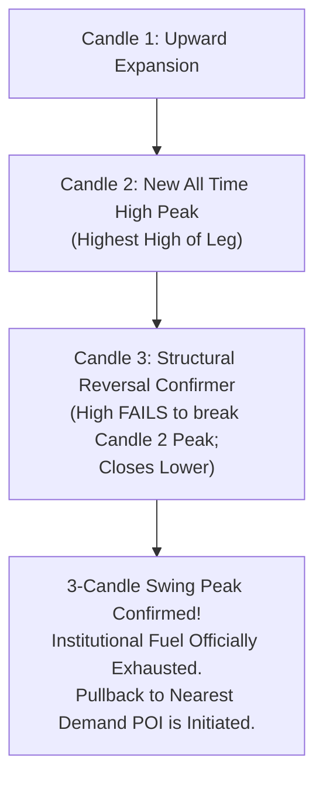
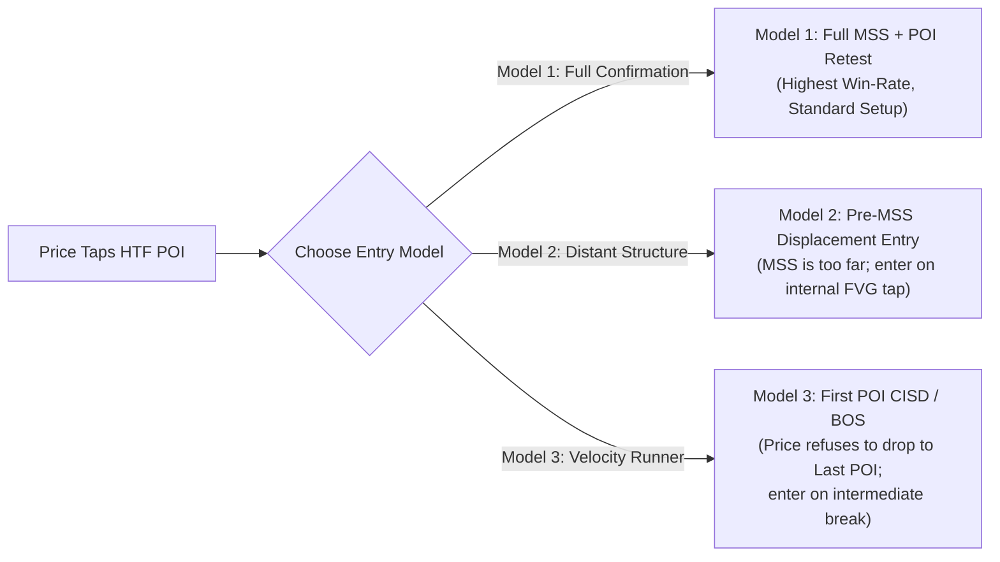

# Video Dossier: Complete Trading Masterclass | Basics to Advanced
## Bias Refinement, All Time High (ATH) Execution & The 3 Operational Entry Triggers

> **Source Video:** [Complete Trading Masterclass | Basics to Advanced | Bias & Entry Modules Explained](https://youtu.be/R5hEMcziYxo)  
> **Instructor:** Shoaib Khan (MS Trading)  
> **Duration:** 58 Minutes 09 Seconds (3,489 Seconds)  
> **Architecture Target:** HERMES MSOB 4.0 Institutional Algorithmic Suite (Step 5: Golden Last POI & Entry Execution)  

---

## 1. Executive Summary & Core Mission

In this 58-minute masterclass, Shoaib Khan addresses the most critical execution questions faced by SMC and ICT traders:
1. **The All Time High (ATH) Trading Paradox:** When price is in price discovery at an All Time High (e.g. Gold or Bitcoin), there is **zero left-side historical data or liquidity** to benchmark turning points. Shoaib codifies the exact mechanical law to trade ATHs without ever trying to predict tops.
2. **The Physics of Price Delivery (Fuel vs Fuel Station):** Why price behaves like a snake, why sweeps represent fuel exhaustion, and why POIs act as institutional fuel refill stations.
3. **The 3 Operational Entry Triggers inside POIs:** Systematizing when to take the full MSS retest, when to execute pre-MSS displacement entries, and how to execute on Decisional First POIs via Change in State of Delivery (CISD).
4. **Volatility Expansion & Dynamic Risk Sizing:** How to adapt position sizing when Daily candle ranges expand 3x to 5x (from 500 pips to 2,500 pips).

---

## 2. The Snake Movement & Fuel Refill Analogy

```
      [ THE SNAKE MOVEMENT & FUEL EXHAUSTION CYCLE ]

  (Expansion Leg)        [ SWING HIGH / LIQUIDITY ]
        ^                (Fuel Depleted! Cannot proceed straight up)
        |                      |
        |                      v (Pullback / Refueling Leg)
  [ DEMAND POI ] <-------------+
  (Fuel Station: Fresh Institutional Orders Injected)
        |
        v
  (Next Expansion Leg to New High)
```

### The Inviolable Delivery Laws:
- Price **never** travels in a straight line. Like a snake slithering forward, it expands, pulls back to gather energy, and expands again.
- **The Contra Analogy:** Price jumps from platform to platform (intermediate POIs). If price misses an upper platform, it drops to the lower platform (extreme base POI) before leaping higher.
- **Eliminating FOMO:** When an initial expansion is missed, a disciplined institutional trader never chases market orders into the air. They know with mathematical certainty that the snake **must** retrace to reload fuel.

---

## 3. The All Time High (ATH) Problem & Sovereign Solution

### The Core Problem at ATH:
At All Time Highs, standard SMC structure mapping fails for retail traders because there are **no left-side swing highs, no historical liquidity pools, and no overhead resistance order blocks**. Retail traders repeatedly blow accounts trying to short "overbought" markets.

### The 3-Candle Swing Confirmation Law at ATH:


### Inviolable ATH Directives:
1. **The Absolute Short Ban:** When price is expanding into ATH, **NEVER attempt to short or pick a top** based on perceived overextension. You MUST remain 100% committed to BUYING dips.
2. **The Pullback Trigger:** Only when a confirmed **3-Candle Swing Peak** forms on the operational timeframe does the institutional algorithm recognize that fuel is depleted and a pullback to the nearest unmitigated Demand POI is commencing.
3. **Buying the ATH Dip:** Once the 3-Candle Swing confirms the pullback, identify the nearest unmitigated 1H/Daily Demand POI (Order Block + FVG) and wait for the sniper entry trigger to ride the next leg to fresh ATHs.

---

## 4. The 3 Operational Entry Triggers inside POIs

Shoaib Khan systematically classified the 3 distinct entry models depending on market structure geometry:



### Detailed Breakdown of the 3 Entry Triggers:

| Parameter | Trigger 1: Full MSS Retest | Trigger 2: Pre-MSS Displacement | Trigger 3: Decisional CISD / BOS |
| :--- | :--- | :--- | :--- |
| **When to Use** | Standard conditions where structural trigger is near. | When the MSS swing point is excessively far away and waiting would forfeit 50%+ of the move. | When market velocity is extreme and price reverses from Decisional POI without touching Last POI. |
| **Execution Trigger** | Price sweeps 5m STH/STL with closed body, retraces to newly formed 5m POI. | Price produces strong displacement candle leaving an open FVG *before* reaching MSS. Enter on FVG tap. | Price taps First POI, prints a Change in State of Delivery (CISD) closing above local high. |
| **Stop Loss Placement** | 2 ticks below 5m ITL / extreme base origin low. | Below the origin displacement candle low. | Below the recent local swing low formed at First POI. |
| **Risk / Reward Profile** | **Ultra-High RR (1:10 to 1:15)** | **High RR (1:7 to 1:10)** | **Moderate RR (1:4 to 1:7)** |
| **Win Rate** | **85% - 90%** | **75% - 80%** | **70% - 75%** |

---

## 5. Petrol Pump A vs B: Decisional vs Extreme POI Selection

Shoaib Khan used the petrol pump analogy to resolve multiple competing POIs:
- **High-Velocity Regime (Urgent Travel / News / Trend Surge):** Price acts like a driver in an emergency who stops at the nearest station (**Petrol Pump A / Decisional First POI**), refuels partially, and roars ahead.
- **Normal / Low-Velocity Regime (Relaxed Travel / Deep Retracement):** Price has time to travel all the way back to the highest quality station (**Petrol Pump B / Extreme Last POI**).
- **The Institutional Parity Check:** Never guess which pump price will use. Monitor lower timeframe displacement! If price touches Pump A and prints a confirmed CISD, take the trade. If it ignores Pump A, let it drop to Pump B.

---

## 6. Multi-Timeframe Alignment Matrix

| Anchor Timeframe (Macro Bias & POI) | Intermediate Timeframe (Structural Confirmation) | Execution Timeframe (Sniper Trigger) |
| :---: | :---: | :---: |
| **Weekly (1W)** | 4-Hour (4H) | 15-Minute (15m) |
| **Daily (1D)** | 1-Hour (1H) | 5-Minute (5m) |
| **4-Hour (4H)** | 15-Minute (15m) | 1-Minute / 3-Minute (1m/3m) |
| **1-Hour (1H)** | 5-Minute (5m) | 1-Minute (1m) |

---

## 7. Volatility Expansion & Dynamic Position Sizing (Pip Inflation)

A crucial insight shared by Shoaib Khan is managing **Pip Inflation**:
- In normal market regimes, Daily Gold/Forex candles measure **500 to 700 pips**. 5m Stop Losses are **30 to 50 pips**.
- In high-velocity ATH regimes, Daily candles expand to **1,500 to 2,500 pips**! 5m Stop Losses expand to **150 to 300 pips**.
- **The Position Sizing Invariant Law:**
  $$\text{Adjusted Lot Size} = \text{Standard Lot Size} \times \left( \frac{\text{Standard SL Distance}}{\text{Expanded SL Distance}} \right)$$
  - Example: If standard SL is 50 pips with 0.10 lots ($50 risk), and the expanded ATH SL is 150 pips (3x wider), you **MUST reduce lot size by 3x to 0.03 lots** so that total risk remains strictly $50.00!

---

## 8. Photographic Keyframe Audit Registry

The 12 extracted visual keyframes from `v_entry2.f398.mp4` document the masterclass:

1. [01_04m30s_psychology_foundation.jpg](file:///C:/Users/power/.gemini/antigravity/brain/cf8480f7-6fe5-4496-9c76-80211255c078/v_entry2_frames/01_04m30s_psychology_foundation.jpg) — Reality check: Avoiding social media show-off; building psychological discipline.
2. [02_09m30s_snake_movement_analogy.jpg](file:///C:/Users/power/.gemini/antigravity/brain/cf8480f7-6fe5-4496-9c76-80211255c078/v_entry2_frames/02_09m30s_snake_movement_analogy.jpg) — The Snake Movement schematic: Continuous zig-zag delivery between Liquidity and POIs.
3. [03_14m30s_fuel_vs_refill.jpg](file:///C:/Users/power/.gemini/antigravity/brain/cf8480f7-6fe5-4496-9c76-80211255c078/v_entry2_frames/03_14m30s_fuel_vs_refill.jpg) — Fuel vs Refill: Sweeps as exhaustion indicators; Order Blocks as refill stations.
4. [04_19m30s_petrol_pump_a_vs_b.jpg](file:///C:/Users/power/.gemini/antigravity/brain/cf8480f7-6fe5-4496-9c76-80211255c078/v_entry2_frames/04_19m30s_petrol_pump_a_vs_b.jpg) — Petrol Pump A vs B: Resolving multiple competing POIs through market velocity.
5. [05_25m00s_ath_trading_strategy.jpg](file:///C:/Users/power/.gemini/antigravity/brain/cf8480f7-6fe5-4496-9c76-80211255c078/v_entry2_frames/05_25m00s_ath_trading_strategy.jpg) — Gold Daily chart at ATH: Showing internal 1H structural steps within the macro leg.
6. [06_30m30s_ath_entry_mechanics.jpg](file:///C:/Users/power/.gemini/antigravity/brain/cf8480f7-6fe5-4496-9c76-80211255c078/v_entry2_frames/06_30m30s_ath_entry_mechanics.jpg) — ATH on-chart proof: 3-candle pullback confirmation entering into stacked Demand POIs.
7. [07_35m30s_crt_candle_range_theory.jpg](file:///C:/Users/power/.gemini/antigravity/brain/cf8480f7-6fe5-4496-9c76-80211255c078/v_entry2_frames/07_35m30s_crt_candle_range_theory.jpg) — The 3 Entry Models schematic: Full MSS vs Pre-MSS displacement vs First POI CISD.
8. [08_40m30s_multi_timeframe_cascade.jpg](file:///C:/Users/power/.gemini/antigravity/brain/cf8480f7-6fe5-4496-9c76-80211255c078/v_entry2_frames/08_40m30s_multi_timeframe_cascade.jpg) — Daily to 1H cascade: Filtering false bounces and waiting for verified displacement.
9. [09_45m30s_live_chart_case1.jpg](file:///C:/Users/power/.gemini/antigravity/brain/cf8480f7-6fe5-4496-9c76-80211255c078/v_entry2_frames/09_45m30s_live_chart_case1.jpg) — 5m live execution: Demonstrating first POI CISD entry and trade management.
10. [10_50m00s_live_chart_case2.jpg](file:///C:/Users/power/.gemini/antigravity/brain/cf8480f7-6fe5-4496-9c76-80211255c078/v_entry2_frames/10_50m00s_live_chart_case2.jpg) — Consecutive winning trade sequence on 1H/5m chart.
11. [11_54m00s_risk_management_armor.jpg](file:///C:/Users/power/.gemini/antigravity/brain/cf8480f7-6fe5-4496-9c76-80211255c078/v_entry2_frames/11_54m00s_risk_management_armor.jpg) — Pip inflation analysis: 500 pip vs 2,500 pip daily candles and lot size calibration.
12. [12_57m00s_masterclass_summary.jpg](file:///C:/Users/power/.gemini/antigravity/brain/cf8480f7-6fe5-4496-9c76-80211255c078/v_entry2_frames/12_57m00s_masterclass_summary.jpg) — Final masterclass review and core execution rules.

---

## 9. Architectural Codification into HERMES MSOB 4.0

1. **ATH Regime Detection Mode:**
   - Detect when price breaks previous historical swing high.
   - Activate the **3-Candle Swing Peak Sentry**: strictly disable all short entries until a validated 3-Candle peak forms on the operational timeframe.
2. **The 3-Trigger Entry Engine:**
   - Code `entry_trigger_type` selector supporting:
     - `TRIGGER_FULL_MSS`: Step 4 MSS + FVG retest.
     - `TRIGGER_PRE_MSS_DISPLACEMENT`: FVG retest before structural breakout when MSS distance > 1.5%.
     - `TRIGGER_DECISIONAL_CISD`: First POI tap + 5m candle close above intermediate high.
3. **Dynamic Pip Inflation Risk Sizer:**
   - Compute ATR / candle range ratio relative to baseline. Automatically adjust isolated margin lot size to guarantee invariant dollar risk ($2.8% max risk).

---
*Dossier codified and locked for Hermes MSOB 4.0 Institutional Algorithmic Trading Architecture.*
