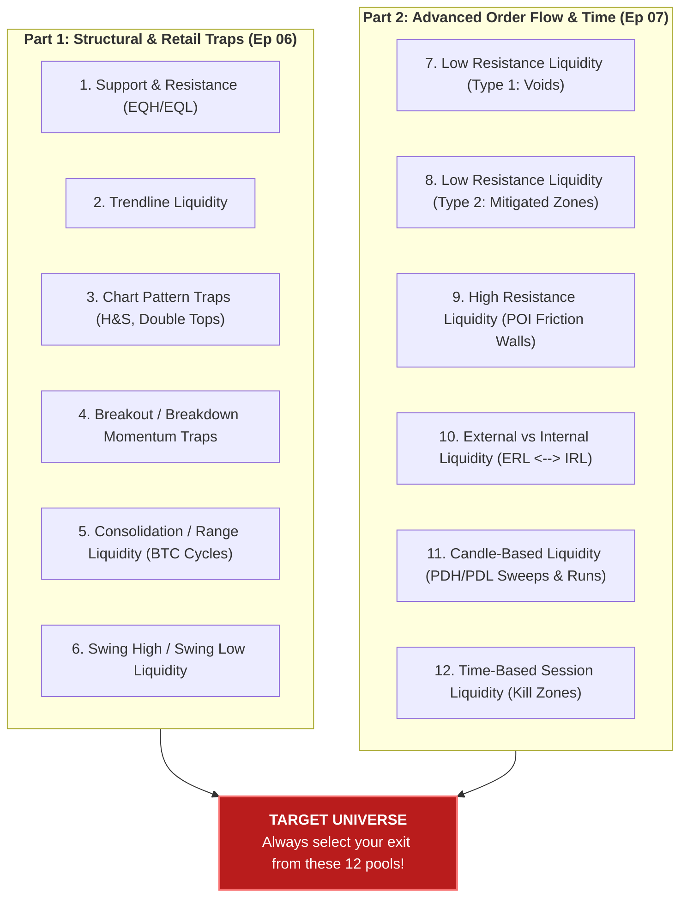

# 🏛️ Hermes Institutional Visual Atlas: Episode 07
**Series:** MS Trading 34-Video Masterclass | **Episode:** 07 (Advanced Liquidity & Dual Target Symmetry)  
**Instructor:** Shoaib Khan | **Source:** [`https://youtu.be/_WEEmT2wgg8`](https://youtu.be/_WEEmT2wgg8)  
**Status:** 100% Forensic Visual Reconstruction Locked  

---

## 🎨 Frame 1: LRL vs HRL & The Liquidity Void Anatomy (02:00 – 11:30)

```
Price ($)
  ▲
  │   ┌────────────────────────────────────────────────────────┐
  │   │ 🔴 FIRST FVG (HIGH RESISTANCE LIQUIDITY - HRL)         │  ◄── Price Stalls &
  │   └────────────────────────────────────────────────────────┘      Consolidates
  │   ░░░░░░░░░░░░░░░░░░░░░░░░░░░░░░░░░░░░░░░░░░░░░░░░░░░░░░░░░░
  │   ░░  INTERMEDIATE FAIR VALUE GAPS                          ░░
  │   ░░  = LIQUIDITY VOIDS                                     ░░  ◄── Price Slices
  │   ░░  = LOW RESISTANCE LIQUIDITY (LRL)                     ░░      Through Fast!
  │   ░░░░░░░░░░░░░░░░░░░░░░░░░░░░░░░░░░░░░░░░░░░░░░░░░░░░░░░░░░
  │   ┌────────────────────────────────────────────────────────┐
  │   │ 🟢 LAST FVG + ORDER BLOCK (HRL - INSTITUTIONAL FLOOR)  │  ◄── Deceleration &
  │   └────────────────────────────────────────────────────────┘      Heavy Consolidation
  ▼
```

---

## 🎨 Frame 2: The Second Type of LRL (Clean/Mitigated Zones) (11:30 – 15:30)

```
Price ($)
  ▲
  │   Zone A: Old Order Block [ALREADY MITIGATED / TAPPED] ──► (No Resting Institutional Bids)
  │   Zone B: Old FVG [ALREADY FILLED] ────────────────────────► (No Resting Limit Orders)
  │   Zone C: Old Breaker [ALREADY TESTED] ────────────────────► (Zero Defense Left)
  │   ════════════════════════════════════════════════════════════════════════════════════
  │   RESULT: ENTIRE ZONE IS "TYPE 2 LOW RESISTANCE LIQUIDITY" (LRL)
  │           When price reverses, it slices through Zone A+B+C in a straight line!
  │   ════════════════════════════════════════════════════════════════════════════════════
```

---

## 🎨 Frame 3: External Range Liquidity (ERL) vs Internal Range Liquidity (IRL) (15:30 – 20:00)

```
Price ($)
  ▲                             [SWING HIGH] ──► 🔴 EXTERNAL RANGE LIQUIDITY (ERL)
  │                                  /\
  │      BOS Occurs                 /  \
  │   ───────────────►             /    \  Retracement Leg
  │                               /      \  (Harvesting Internal Liquidity)
  │                              /        ▼
  │                             /      ┌─────────────────────────────┐
  │                            /       │ ⚡ INTERNAL RANGE LIQUIDITY │
  │                           /        │ (IRL: FVG / Decisional OB)  │
  │                          /         └──────────────┬──────────────┘
  │                         /                         │ Reversal & Expansion
  │                        /                          ▼
  │   [SWING LOW] ────────/───────────────────────────► Targets Next ERL!
  │        ▲
  │        └─── 🟢 EXTERNAL RANGE LIQUIDITY (ERL)
```
- **The Perpetual Loop:** $\mathbf{ERL \longrightarrow IRL \longrightarrow ERL \longrightarrow IRL}$.

---

## 🎨 Frame 4: Daily Candle Liquidity Sweep vs Run (The 4-Day Gold Walkthrough) (20:00 – 26:20)

```
SCENARIO A: LIQUIDITY SWEEP (REVERSAL BIAS)       SCENARIO B: LIQUIDITY RUN (EXPANSION BIAS)
===========================================       ===========================================
               Wick Sweeps PDH                                 Candle Body Closes
                     │                                         ABOVE PDH
                     ▲                                             ┌──┐
              ───────┼─────── [PDH]                         ───────┤  ├─────── [PDH]
                   ┌──┴──┐                                         │  │
                   │     │                                         │  │
                   │     │ Body Closes Below                       │  │
                   └──┬──┘                                         └──┘
                      │
                      ▼                                            Next Day Bias:
               Next Day Bias:                                      🟢 BULLISH CONTINUATION
               🔴 BEARISH REVERSAL DAY                             (Liquidity Run in Progress)
```

---

## 🎨 Frame 5: Time-Based Session Liquidity & The London Judas Swing (26:20 – 30:30)

```
Price ($)
  ▲
  │   ──────────────── Asian High ──────────────────────────────
  │   │                     ▲
  │   │  ASIAN RANGE        │ Asian
  │   │  (Accumulation)     │ Sweep ───► London Judas Swing
  │   ──────────────── Asian Low ───────────────────────┼───────
  │                                                     ▼
  │                                          [LONDON FVG + OB FORMED]
  │                                                     ▲
  │                                                     │ Tap & Launch
  │                                                     │
  │                                              [NEW YORK MACRO EXPANSION]
  │                                              (Explosive Day Trend)
```

---

## 🎨 Frame 6: The Dual Target Symmetry Law (35:00 – 36:42)

```
┌─────────────────────────────────────────────────────────────────────────────┐
│                    THE DUAL TARGET SYMMETRY LAW                             │
├─────────────────────────────────────────────────────────────────────────────┤
│                                                                             │
│   CASE 1: ENTRY AT POI                                                      │
│   [ 1H Order Block / FVG / Breaker ] ═══════════════► TARGET: LIQUIDITY     │
│                                                       (One of 12 Pools)     │
│                                                                             │
│   CASE 2: ENTRY AT LIQUIDITY SWEEP                                          │
│   [ Turtle Soup / Stop Run of EQH/EQL/PDH/PDL ] ════► TARGET: POI           │
│                                                       (Opposing OB / FVG)   │
│                                                                             │
└─────────────────────────────────────────────────────────────────────────────┘
```

---

## 🎨 Frame 7: The Complete 12-Liquidity Target Universe Map


